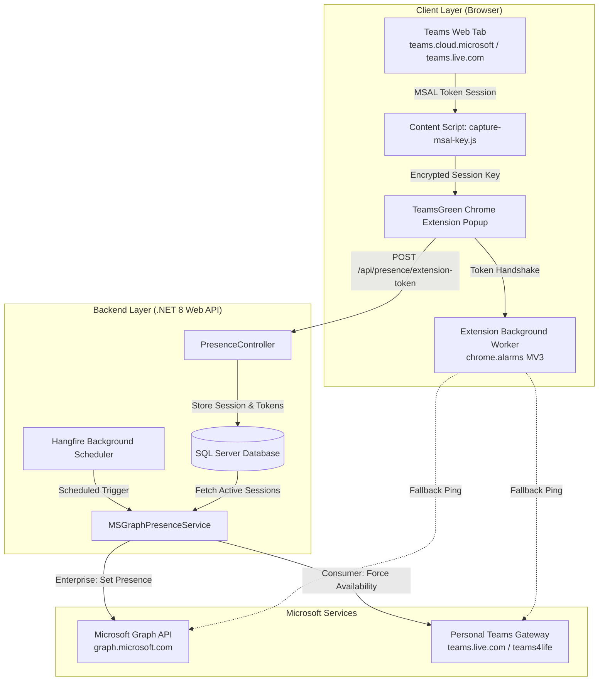

# 🟢 TeamsGreen — Autonomous Microsoft Teams Presence Automation & Keep-Alive Engine

[](https://dotnet.microsoft.com/)
[](https://learn.microsoft.com/en-us/dotnet/csharp/)
[](https://www.hangfire.io/)
[](https://developer.chrome.com/docs/extensions/mv3/intro/)
[](https://www.microsoft.com/sql-server)
[](https://www.docker.com/)

> **TeamsGreen** is an enterprise-grade, cloud-backed presence automation system for Microsoft Teams. Unlike fragile mouse jigglers or OS-level input simulators that trigger corporate security alerts, TeamsGreen works directly at the **protocol and API level** via native Microsoft authentication tokens.
>
> It features a **Manifest V3 Chrome Extension** paired with an autonomous **.NET 8 Web API backend + Hangfire scheduling engine** that maintains your active "Available" status even when your browser or PC is closed.

---

## 💡 The Problem & The Solution

| Traditional Solutions (Mouse Jigglers / Scripts) | TeamsGreen Architecture |
| :--- | :--- |
| ❌ Detected by corporate IT endpoint telemetry (EDR/MDM). | ✅ **100% Native API calls**: Looks identical to authentic user activity. |
| ❌ Requires laptop to remain open and unlocked. | ✅ **Autonomous Cloud/Server Backend**: Works 24/7 even when PC is asleep. |
| ❌ Interrupts active typing or mouse movements. | ✅ **Zero UI interference**: Operates silently over HTTPS. |
| ❌ Often blocked by corporate Group Policy / AppLocker. | ✅ **No desktop installation required**: Chrome extension + Dockerized backend. |

---

## 🏛️ System Architecture



---

## ✨ Key Architectural Features

### 🔐 1. In-Memory MSAL Session Hooking (No Azure Admin Consent Required)
Enterprise organizations restrict custom Azure AD App registrations. TeamsGreen bypasses this roadblock cleanly:
* The extension injects into the authentic **Teams Web** tab (`teams.cloud.microsoft` and `teams.live.com`).
* Hooks into the browser's `SubtleCrypto` API to decrypt the browser's active MSAL (Microsoft Authentication Library) token cache.
* Retrieves valid Microsoft Graph bearer tokens and SkypeTokens directly from your authenticated browser session.

### 🌐 2. Dual Account Architecture (Work & Personal)
* **Enterprise Accounts (`teams.cloud.microsoft`)**: Interfaces with Microsoft Graph Presence API (`/v1.0/me/presence/setUserPreferredPresence`) and `presence.teams.microsoft.com`.
* **Personal / Consumer Accounts (`teams.live.com` / `teams4life`)**: Emulates authenticated CDL worker presence calls with dedicated SkypeToken headers to `PUT teams.live.com/ups/global/v1/me/forceavailability/`.

### ⏱️ 3. Resilient Hangfire Server Automation
* Uses **Hangfire** backed by SQL Server storage to manage recurring presence refresh jobs.
* Automatically refreshes expiring tokens and checks presence at customizable intervals.
* Supports working hours scheduling (e.g. 09:00 - 18:00 IST), excluding weekends or holidays to mimic natural human schedules.

---

## 📁 Repository Structure

```text
TeamsGreen/
├── Controllers/                 # REST API endpoints (Presence, Configuration)
├── Data/                        # Repository layer (Dapper & EF Core database access)
├── Entities/                    # Data models (TenantSession, UserConfig, PresenceLog)
├── Hangfire/                    # Background scheduler jobs and dashboard setup
├── Services/                    # Microsoft Graph & Teams presence HTTP services
├── extension/                   # Manifest V3 Chrome Extension
│   ├── manifest.json            # Extension configuration & content script rules
│   ├── popup.html / popup.js    # Extension UI and token sync interface
│   ├── background.js            # Background service worker with chrome.alarms
│   └── capture-msal-key.js      # Main-world script hooking Web Crypto API
├── Dockerfile                   # Multi-stage production container build
├── docker-compose.yml           # Deployment configuration with environment injection
├── script.sql                   # SQL Server database schema initialization
├── Program.cs                   # Application entry point & DI configuration
└── appsettings.json             # Application configuration template
```

---

## 🚀 Getting Started

### Prerequisites
* [.NET 8.0 SDK](https://dotnet.microsoft.com/download/dotnet/8.0)
* [SQL Server 2019+](https://www.microsoft.com/sql-server) (or Azure SQL / Docker SQL Server)
* Google Chrome, Brave, or Microsoft Edge browser

---

### Step 1: Database Setup
Run [`script.sql`](script.sql) against your SQL Server instance:
```bash
sqlcmd -S localhost -U sa -P "YourPassword" -i script.sql
```

---

### Step 2: Backend Configuration & Run
1. Configure connection string in your local `appsettings.Development.json` (git-ignored):
```json
{
  "ConnectionStrings": {
    "DefaultConnection": "Server=localhost,1433;Database=TeamsKeepAliveDb;User Id=sa;Password=YourPassword;TrustServerCertificate=True"
  }
}
```
2. Build and run:
```bash
dotnet restore
dotnet build
dotnet run
```
The Swagger UI will be available at `http://localhost:5000/swagger`, and the Hangfire Dashboard at `http://localhost:5000/hangfire`.

---

### Step 3: Install Chrome Extension
1. Open Chrome/Edge and navigate to `chrome://extensions`.
2. Enable **Developer mode** (top right toggle).
3. Click **Load unpacked** and select the [`extension/`](extension/) directory from this repository.
4. Log into [Teams Web](https://teams.microsoft.com).
5. Click the **TeamsGreen** extension icon and click **Sync Session** to connect tokens with your backend API.

---

## 🐳 Docker Deployment

A lightweight, multi-stage `Dockerfile` and `docker-compose.yml` are included for home lab or VPS deployment (e.g. TrueNAS SCALE, Docker Swarm):

```bash
docker-compose up -d --build
```

---

## 🛡️ Security & Privacy Notice

* **No Credentials Stored**: Passwords and MFA secrets are **never** captured or handled. Only temporary OAuth2 access/refresh tokens are utilized.
* **Encrypted Storage**: Sensitive tokens in the database are handled using secure connection strings and restricted table schemas.
* **Responsible Use**: Intended for productivity management, preventing unwanted "Away" statuses while reading documentation, reviewing code, or taking brief breaks during official working hours.

---

## 👨‍💻 Author

**Himanshu Patil**
* GitHub: [@HimanshuPatil2001](https://github.com/HimanshuPatil2001)
