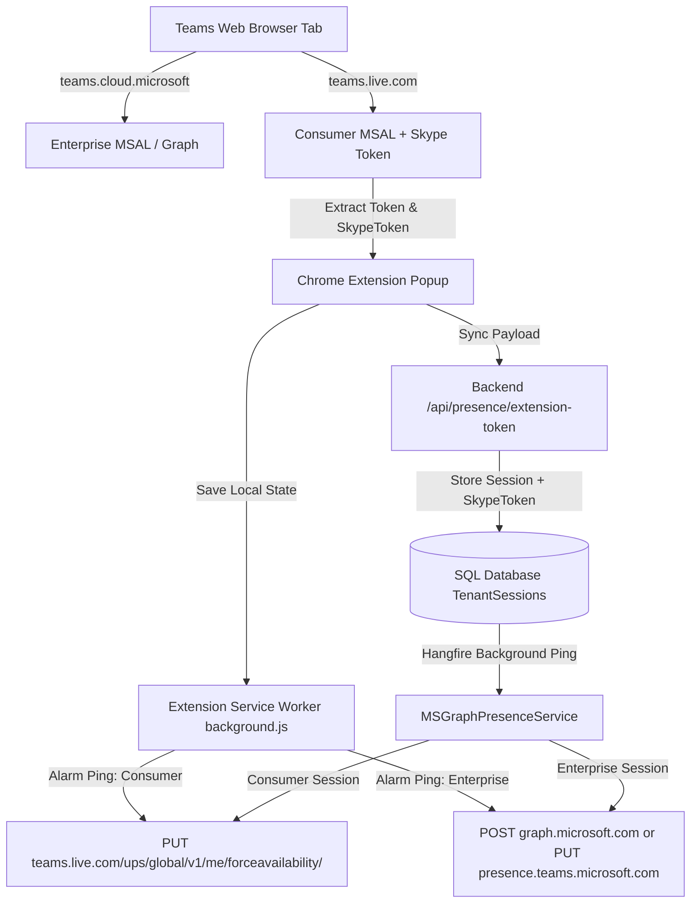

# Implementation Plan: Personal Teams (`teams.live.com`) Presence Support

Support personal Microsoft Teams accounts (`teams.live.com` / `teams4life`) in addition to existing Work & Enterprise Teams accounts (`teams.cloud.microsoft` / Microsoft Graph).

---

## 🎯 Goal & Background

The verified working `curl` command confirms the exact endpoint and required headers for Personal Teams presence updates:
* **Endpoint**: `PUT https://teams.live.com/ups/global/v1/me/forceavailability/`
* **Payload**: `{"availability":"Available"}`
* **Required Headers**:
  - `authorization: Bearer <Encrypted_JWE_or_Access_Token>`
  - `x-skypetoken: <Skype_Token>`
  - `x-ms-client-consumer-type: teams4life`
  - `x-ms-client-caller: TeamsClient:setPresenceAvailability`
  - `x-ms-client-user-agent: Teams-V2-Web`
  - `x-ms-client-type: cdlworker`
  - `x-ms-client-version: 1415/26080200346`
  - `x-ms-endpoint-id: <GUID>`
  - `x-ms-session-id: <GUID>`
  - `behavioroverride: redirectAs404`
  - `Referer: https://teams.live.com/v2/worker/precompiled-web-worker-061a7815ccf84e04.js`

This requires updates across:
1. **Chrome Extension** (`manifest.json`, `popup.js`, `background.js`): Capture SkypeToken from `teams.live.com`, inject keys on `teams.live.com`, and route background pings to the personal endpoint when on personal accounts.
2. **Backend Service & API** (`MSGraphPresenceService.cs`, `PresenceController.cs`, `Entities/TenantSession.cs`, `KeepAliveRepository.cs`): Support storing and dispatching requests to `teams.live.com` with all requisite consumer headers.

---

## 🏗️ Architecture & Flow



---

## 🔍 Proposed Changes

### Component 1: Chrome Extension

#### [MODIFY] [manifest.json](file:///D:/Himanshu/Project/TeamsGreen/extension/manifest.json)
- Add `"https://teams.live.com/*"` to content scripts match list so AES-GCM cache encryption keys are captured on `teams.live.com`.

#### [MODIFY] [popup.js](file:///D:/Himanshu/Project/TeamsGreen/extension/popup.js)
- Update `extractFromMSAL()` to detect and extract `skypeToken` from `sessionStorage`/`localStorage` (including decrypted entries or cache keys).
- Detect if account is consumer (`teams.live.com` / `teams4life` / MSA tenant) and pass `skypeToken` and `accountType` in the payload sent to `/api/presence/extension-token`.
- Save `skypeToken` in `chrome.storage.local` for the background worker.

#### [MODIFY] [background.js](file:///D:/Himanshu/Project/TeamsGreen/extension/background.js)
- Update `callSetPresence()`:
  - If `skypeToken` is present or account is personal (`teams.live.com`), make a `PUT` request to `https://teams.live.com/ups/global/v1/me/forceavailability/` with all required consumer headers (`x-skypetoken`, `x-ms-client-consumer-type: teams4life`, `x-ms-client-caller: TeamsClient:setPresenceAvailability`, etc.).
  - Otherwise fall back to `https://presence.teams.microsoft.com/v1/me/forceavailability/` or `https://graph.microsoft.com/v1.0/me/presence/setPresence`.

---

### Component 2: Backend Entities & Database

#### [MODIFY] [TenantSession.cs](file:///D:/Himanshu/Project/TeamsGreen/Entities/TenantSession.cs)
- Add optional `SkypeToken` property:
  ```csharp
  public string? SkypeToken { get; set; }
  ```

#### [MODIFY] [KeepAliveRepository.cs](file:///D:/Himanshu/Project/TeamsGreen/Data/KeepAliveRepository.cs)
- Update SQL queries in `UpsertSessionAsync`, `GetActiveSessionsAsync`, `GetSessionByIdAsync`, `GetSessionByEmailAsync`, and `MapSession` to handle `SkypeToken`.

#### [MODIFY] [script.sql](file:///D:/Himanshu/Project/TeamsGreen/script.sql)
- Include `SkypeToken NVARCHAR(MAX) NULL` column with safe `IF COL_LENGTH(...) IS NULL ALTER TABLE...` check.

---

### Component 3: Backend API & Service

#### [MODIFY] [PresenceController.cs](file:///D:/Himanshu/Project/TeamsGreen/Controllers/PresenceController.cs)
- Update `ExtensionTokenRequest` model to accept `SkypeToken`.
- Map `SkypeToken` to `TenantSession` when upserting sessions via `/api/presence/extension-token` and `/api/presence/session`.

#### [MODIFY] [MSGraphPresenceService.cs](file:///D:/Himanshu/Project/TeamsGreen/Services/MSGraphPresenceService.cs)
- In `KeepAliveAsync()`:
  - Detect if session is Personal Teams (by presence of `SkypeToken`, `TenantId` matching consumer tenants `9188040d-6c67-4c5b-b112-36a304b66dad` / `f8cdef31-a31e-4b4a-93e4-5f571e91255a`, or email domain).
  - Construct `PUT https://teams.live.com/ups/global/v1/me/forceavailability/` with:
    - `authorization: Bearer <accessToken>`
    - `x-skypetoken: <skypeToken>`
    - `x-ms-client-consumer-type: teams4life`
    - `x-ms-client-caller: TeamsClient:setPresenceAvailability`
    - `x-ms-client-user-agent: Teams-V2-Web`
    - `x-ms-client-type: cdlworker`
    - `x-ms-client-version: 1415/26080200346`
    - `x-ms-endpoint-id: session.Id`
    - `x-ms-session-id: session.Id`
    - `behavioroverride: redirectAs404`
    - `Referer: https://teams.live.com/`
    - `Content-Type: application/json`
    - `{"availability": session.TargetPresenceState}`

---

## 🧪 Verification Plan

### Automated Build & Test
1. Build backend project:
   ```powershell
   dotnet build D:\Himanshu\Project\TeamsGreen\TeamsGreen.csproj
   ```
2. Verify all C# files compile without errors or warnings.

### Manual Verification
1. **Extension Verification**:
   - Load unpacked extension in Chrome.
   - Open `teams.live.com` and open extension popup.
   - Click "Save Configuration" / "Connect".
   - Verify `SkypeToken` and `AccessToken` are extracted and synced successfully to the backend.
2. **Backend Ping Verification**:
   - Trigger manual ping via backend API:
     ```bash
     curl -X POST "http://localhost:32768/api/presence/ping/<SESSION_ID>"
     ```
   - Check logs in database / API to verify `200 OK` or `204 No Content` returned from `teams.live.com`.
